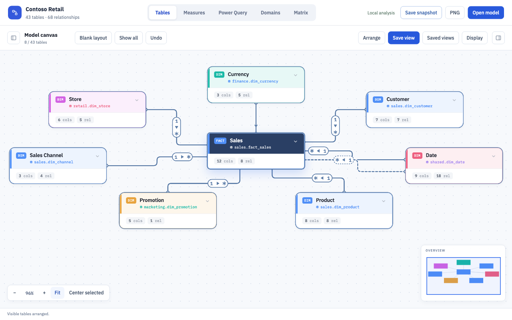
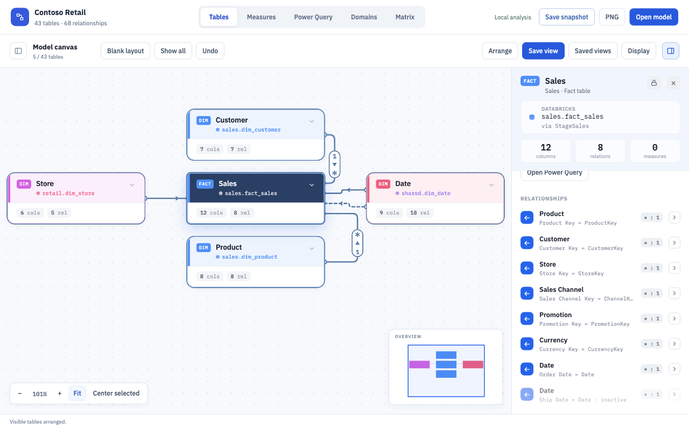
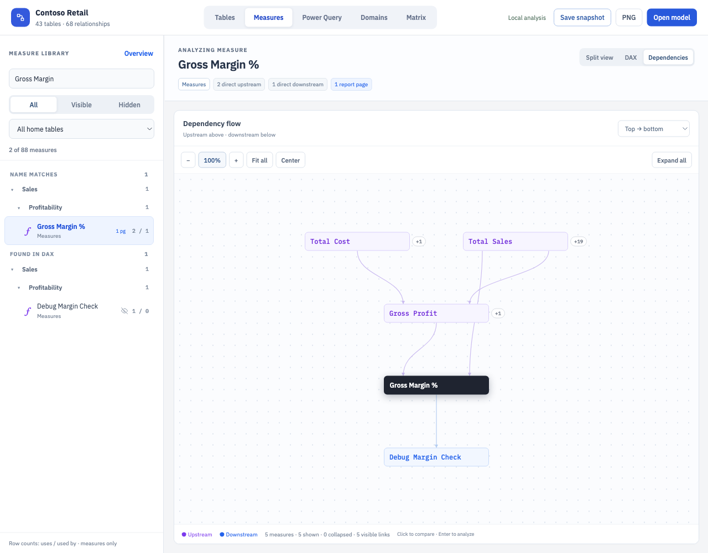
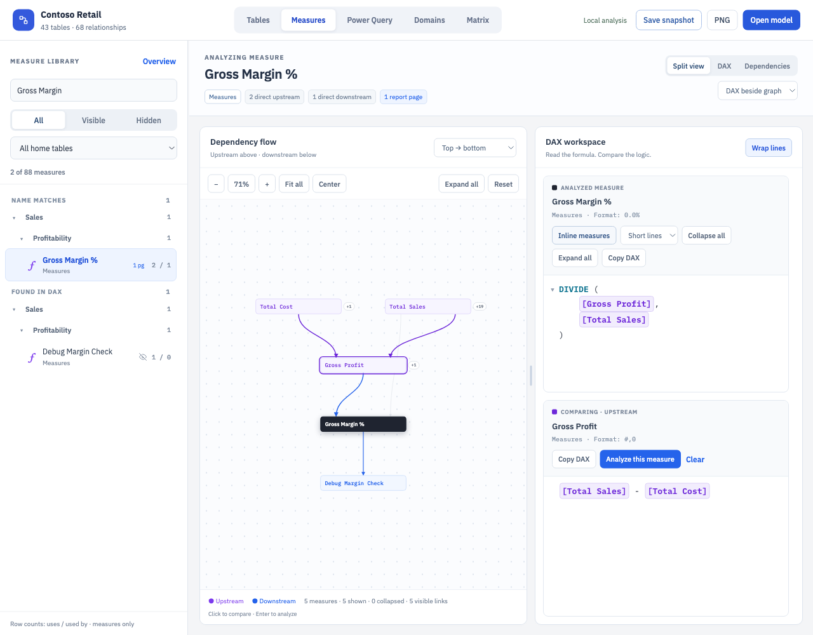
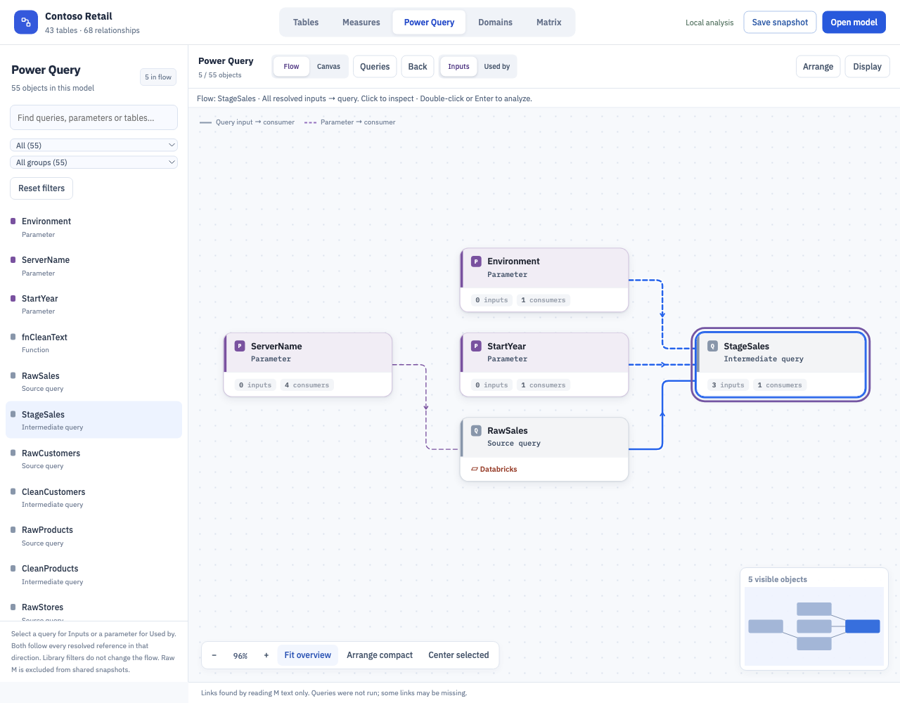
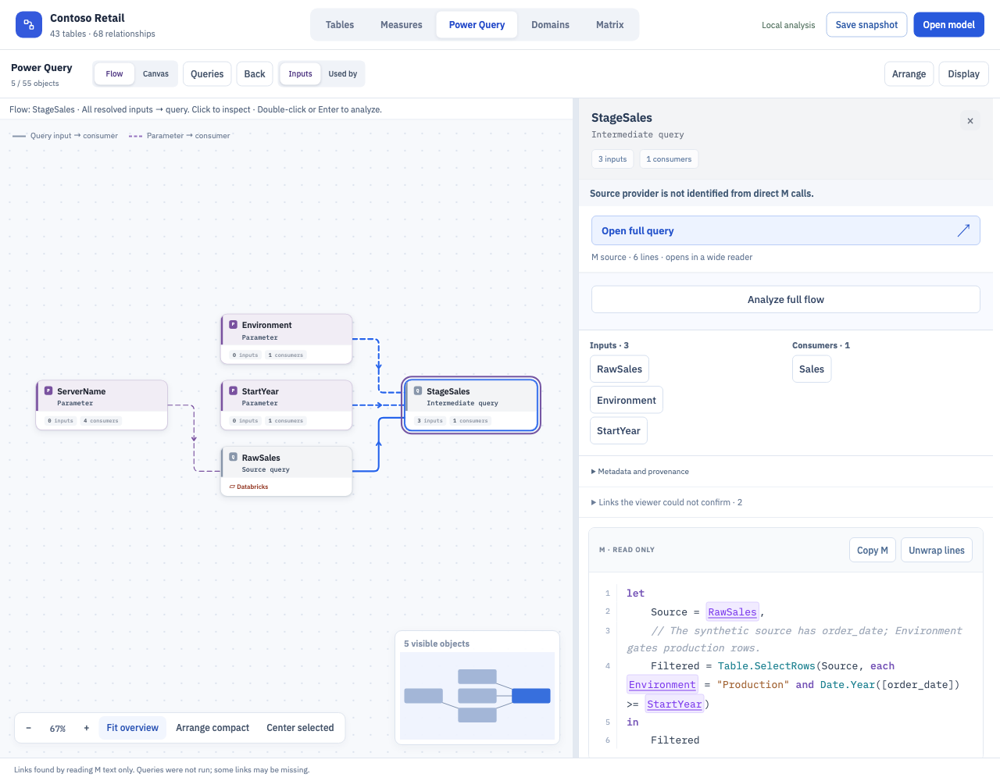
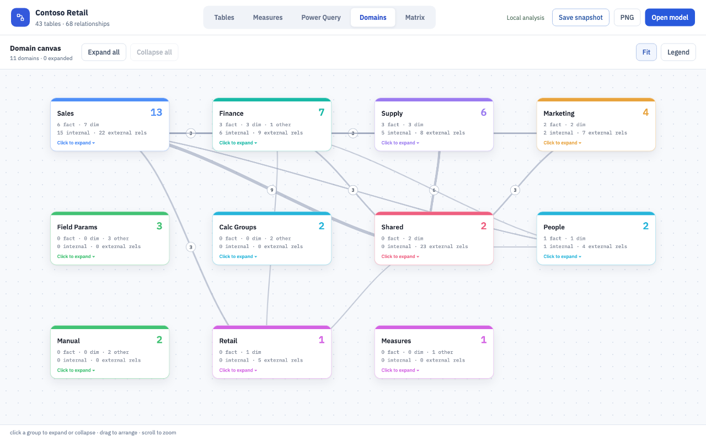
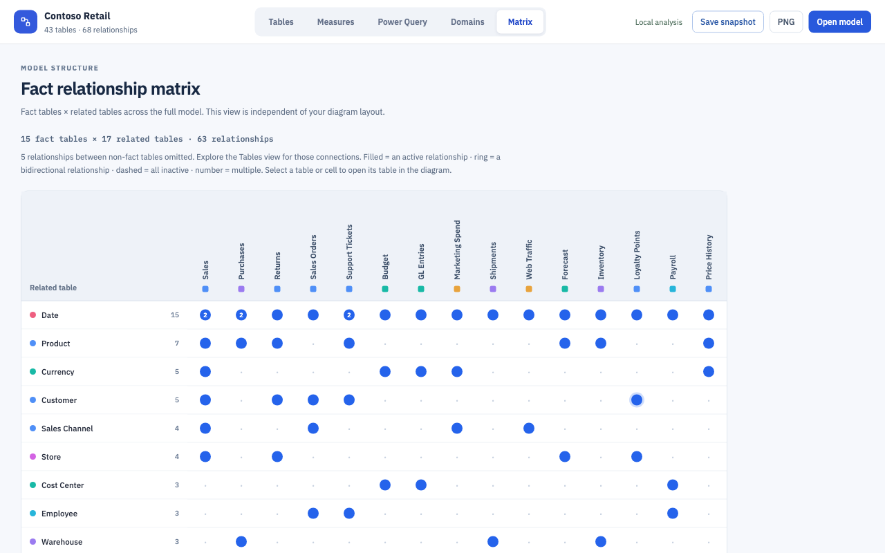

# Semantic Model Viewer

**Understand how a Power BI semantic model fits together: tables, relationships, DAX, and Power Query.**

For Power BI developers and consultants exploring, maintaining, or handing over models.
The browser viewer and local app parse your model metadata on your computer without uploading it.

**[Try in browser](https://MrPerfectH.github.io/Semantic-Model-Viewer/)** · **[Windows portable ZIP](docs/installation.md#windows-portable-version)** · **[VS Code extension](https://marketplace.visualstudio.com/items?itemName=MrPerfectH.semantic-model-viewer)**

The browser demo opens with a synthetic **Contoso Retail** model. No installation or account is needed.

**[Learning library: watch recordings, download PDF walkthroughs, and follow the guides](docs/learning-library.md)**

## Get started

| Where | First steps | Requirements |
| --- | --- | --- |
| Windows portable | Extract the ZIP and double-click **Run Semantic Model Viewer.cmd**. | Windows x64 and a browser; no installation or separate Python setup. |
| Browser | Open the demo, then choose **Open model** to import your own model. | A desktop browser; Chrome/Edge also support connecting a repository folder. |
| VS Code | Install the extension, open your project folder, then select a model in **Semantic Models**. | VS Code; no Python or Power BI Desktop needed for local model files. |
| Mac / run from source | Follow the [repository setup](docs/installation.md#run-from-a-repository-checkout). | Python 3 and a browser. |

See the [portable download instructions](docs/installation.md#windows-portable-version) for package availability.

In **Tables**, add **Sales** with **+**, select it, and explore its filter paths.
In **Measures**, select a measure to follow its dependencies and inspect the DAX.

**Supported files:** TMDL (`*.SemanticModel` folders and PBIP project folders) and `model.bim`.
A `.pbip` file alone is not the model; `.pbix` files cannot be opened directly.
See [supported input and troubleshooting](docs/installation.md#supported-input).

## What you can do

### Explore tables and relationships

Build a canvas around the tables you care about. Read cardinality and filter direction,
follow active and inactive relationships, and inspect table and column details.
Add related tables, highlight filter paths, hide unrelated objects, and choose among
automatic layouts. Pan, zoom, use the minimap, pin tables, save named views, and undo layout edits.

| Relationship canvas | Table inspector |
| --- | --- |
|  |  |

[Tables and layout guide](docs/viewer-guide.md#tables)

### Trace measure dependencies and understand DAX

See what feeds a measure and what depends on it. Start from a table or column to find
direct and indirect dependent measures, then inspect their formulas without losing
the selected source. Search by name, folder, home table, or DAX; identify hidden
measures and report usage when report metadata is loaded.

Read DAX beside the graph, compare formulas, format expressions, and inline referenced
measures to inspect the expanded calculation. Optional table and column references
show which model objects the visible measures use.

| Dependency flow | DAX comparison |
| --- | --- |
|  |  |

[Measures guide](docs/viewer-guide.md#measures) · [Table and column dependencies](docs/viewer-guide.md#table-and-column-references) · [Watch a 35-second workflow](https://MrPerfectH.github.io/Semantic-Model-Viewer/media/vscode-guide/vscode-to-dax-v4.mp4)

### Follow Power Query flows and read M

Explore queries, parameters, functions, and table partitions as inputs and consumers.
Trace upstream or downstream, filter the inventory, and inspect a query without losing
the flow target. Read line-numbered M beside the graph or in the full query reader,
copy the exact definition, jump through resolved references, and use Back to retrace your steps.
Missing definitions, unresolved references, and analysis limitations remain visible.

| Query input flow | M and query details |
| --- | --- |
|  |  |

[Power Query guide](docs/viewer-guide.md#power-query)

### See the whole model with Domains and Matrix

Use **Domains** to explore groups of related tables and their connections, expanding
groups when you need more detail. Use **Matrix** to compare fact tables against their
related tables and spot shared dimensions, multiple relationships, and filter behavior.

| Domain map | Relationship matrix |
| --- | --- |
|  |  |

[Domains and Matrix guide](docs/viewer-guide.md#additional-domains-and-matrix)

### Share an interactive model, without installing the Viewer

Choose **Save snapshot** to export one HTML file that your colleague opens in a
desktop browser. They can explore the model, compare formulas, change the layout,
and save another snapshot without a model connection, installation, or internet access.
Your saved views, presentation, DAX, and available Power Query definitions travel with the file.

A focused canvas still exports the **full model metadata**, including DAX and available M.
Endpoint strings and parameter values written in M are included. Share the file with
people who should see those definitions.

[Snapshot sharing guide](docs/snapshots.md)

### Fit the Viewer into your workflow

Use the browser, repository launchers, or VS Code extension. Switch between
Classic and Spellbook appearances in the browser app, and preserve the chosen
presentation in interactive snapshots. The [snapshot CLI](docs/cli.md) can export
an offline model view from TMDL without opening a browser.

The searchable Reference workspace, Claude Code plugin, and agent-authored visual
explanations are in development. They are separate from the stable features shown above.
The portable Windows build is also prepared locally; see the
[download status](docs/installation.md#windows-portable-version) before choosing that route.

Dependency analysis is static. The Viewer does not execute DAX or M or fetch source data;
links it cannot resolve remain explicit. See the [viewer guide](docs/viewer-guide.md) for workflows and limitations.

## Documentation

| I want to… | Guide |
| --- | --- |
| Browse recordings, PDF walkthroughs, and learning materials | [Learning library](docs/learning-library.md) |
| Install, update, or open my own model | [Installation and troubleshooting](docs/installation.md) |
| Explore the views and see more screenshots | [Viewer guide](docs/viewer-guide.md) |
| Share a portable model | [Interactive snapshots](docs/snapshots.md) |
| Export a snapshot from the command line | [CLI](docs/cli.md) |
| Understand data handling | [Security and privacy](SECURITY.md) |
| Develop or contribute | [Developer guide](docs/development.md) · [Contributing](CONTRIBUTING.md) |

## Related tools

[**Semantic Model Cleaner**](https://github.com/MrPerfectH/Semantic-Model-Cleaner)
helps review apparently unused model items across selected PBIR reports and apply
local cleanup actions. Use the Viewer to understand a model and the Cleaner to review cleanup opportunities.
See the Cleaner repository for its beta status, setup, and analysis limitations.

[**Model Alchemist**](https://github.com/goreckir/model_alchemist)
compares two Power BI semantic models in TMDL format, shows object-level differences,
and lets you deploy selected changes to a local model or Microsoft Fabric.
Use it to review differences between model versions and promote chosen changes.

## Feedback and contributing

[Report a bug or suggest a feature](https://github.com/MrPerfectH/Semantic-Model-Viewer/issues/new/choose).
Use the synthetic demo or a small made-up model in public reports.
For code contributions, read [CONTRIBUTING](CONTRIBUTING.md); report security issues
[privately](SECURITY.md#report-a-vulnerability).

Built and maintained by **Przemek Harazny** ([@MrPerfectH](https://github.com/MrPerfectH))
as a personal open-source project. Released under the [MIT License](LICENSE).
Demo models and screenshots use synthetic data.
