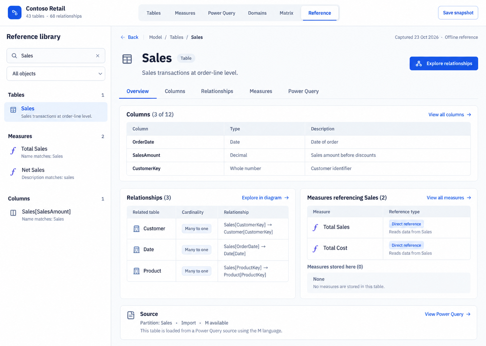

# Searchable semantic model reference and portable documentation

Status: **Deferred by the product owner on 2026-10-28.**

Priority now: polish the existing Semantic Model Viewer. Resume this feature only
when it is deliberately reprioritized. There is no target release or delivery date.

## Product idea

Make Semantic Model Viewer a searchable, visual reference for understanding and
sharing a semantic model. A developer should be able to find an object, read its
definition and existing model description, understand its connections, and jump
into the existing relationship, measure dependency, or Power Query views.

The same reference should work inside a single offline HTML snapshot. Recipients
should need no repository, installation, authentication, or connection to the model.
This supports development, reviewing changes made by an agent, onboarding,
handover, and sharing model structure with people who do not have source access.

This extends the viewer's visual analysis strengths. Tabular Editor remains the
authoring tool; Semantic Model Cleaner owns the connected model/report workflow.
Model comparison belongs to the separate comparison tool discussed by the owner.
Existing documentation tools were considered, but generated documentation alone
is not the distinction: the value is easy discovery, connected exploration, and
portable visual presentation.

## Agreed future scope

1. **Preserve documentation metadata.** Audit the complete path from TMDL/BIM
   import to normalized model, display, and snapshot export. Preserve supported
   descriptions, expressions, formatting, calculation-group properties,
   hierarchies, and partition metadata consistently across JavaScript and Python
   import paths. State the supported inventory and distinguish missing metadata
   from unsupported or unavailable metadata. Do not call the representation
   complete until coverage has been verified.
2. **Add a searchable model reference.** Search names, descriptions, folders,
   and optionally DAX/M; filter by object type. Give tables, columns, measures,
   calculation groups/items, hierarchies, and query objects linked detail pages.
   Explain search matches, provide Back navigation, and connect the pages to the
   existing visual workspaces.
3. **Include the reference in offline snapshots.** Embed the metadata, search,
   object navigation, contextual tabs, and selected starting page. Preserve
   offline exploration and re-export. Show provenance, capture/opening time when
   actually known, snapshot creation time, and coverage limitations.

Power BI Service extraction is being developed in another session. It is outside
this backlog item's scope. When available, it should feed the same normalized
model and existing snapshot path rather than require a second reference/export UI.

## Selected design direction

The owner selected the **first mockup: a searchable reference library with a
full reading pane and additional tabs**.

The mockup is a layout concept with synthetic content; labels, counts, and
technical relationships must be validated against actual model metadata.

- Left: persistent search, object-type filter, and grouped results.
- Right: breadcrumb and Back, object name/type, existing model description,
  contextual tabs, and a primary action opening the relevant visual view.
- Table tabs: Overview, Columns, Relationships, Measures, and Power Query;
  expose hierarchy and property details where useful.
- Calculation groups: dedicated item list, precedence, ordinals, definitions,
  formatting, and detected dependencies.
- Overview: a short columns preview, relationship summary, measures referencing
  the table, measures stored in the table, and source/query information.
- Object links should support continued exploration and a return to the
  previous context. Long definitions need a readable expression view.

Two other layouts were explored: an object page with a relationship mini-map,
and a canvas with an expanded reference inspector. The first library layout is
the chosen direction; those alternatives are not additional implementation work.

## Trust and interpretation

- Keep source properties distinct from derived findings such as inferred table
  roles and static dependency analysis.
- Measures stored in a table are not necessarily measures that reference its
  data. Show those lists separately; distinguish direct and indirect references.
- `SELECTEDMEASURE()` is context-dependent. Do not turn it into an invented
  fixed dependency on every measure.
- Missing report usage does not establish that an object is unused. Partial
  DAX/M analysis must not imply complete lineage or execution behavior.
- Show existing model descriptions. Missing business meaning cannot reliably
  be recovered from formulas alone.
- A snapshot documents a captured version; it cannot establish the current
  state of a live source. Re-export time must not be confused with capture time.
- Search and canvas filtering do not redact an exported model. Existing exports
  can contain exact DAX/M, endpoints, and parameter values. Export-scope controls
  were discussed as a possible later refinement and are not an agreed initial
  deliverable; any future redaction must remove content from the file itself.

## Explicit exclusions

- AI assistance or generated descriptions as a requirement for this feature.
- Model version comparison, change history, or a duplicate comparison engine.
- A separate authored-notes/review system or another documentation maintenance
  workflow. Reading descriptions maintained in the source model is in scope.
- Authoring or editing model definitions.
- Service authentication and workspace/model connection UI in this workstream.

## Success criteria when resumed

A colleague receives a single HTML file, searches for a table or measure,
understands its available definition and connections, and follows those
connections without an explanation of where to click. The reference behaves
consistently in the app and offline, and makes missing information visible.

Verify metadata preservation and import parity, scoped object identities,
search/filter behavior, tab and Back navigation, links to visual workspaces,
model replacement, readable layouts, safe rendering of source text, and offline
export/re-export/restore before treating the feature as release-ready.

## Existing exploration to assess before resuming

An experimental implementation was made during this discussion, before the
decision to defer. It remains in the shared working tree, including
`js/reference.js`, `reference.css`, importer and snapshot changes, and reference
tests. This backlog update does not remove or disable those changes. They must
not be mistaken for an approved release merely because the design was selected.
Other sessions have edits in the same files, so avoid blanket resets.

Review [the implementation coverage notes](../../model-reference.md) and the
[design QA record](../../../design-qa.md) as historical exploration, not current
release sign-off. At the last run, focused metadata tests and offline browser
acceptance passed; the complete suite was 749/751, with two remaining canvas
preset expectation failures. These results need to be rerun when work resumes.

Before resuming, inspect the then-current code, reconcile changes from other
sessions, and decide which experimental pieces to retain. The implementation
notes currently exclude security roles, perspectives, translations, arbitrary
annotations, and calculation selection expressions; future scope should make
those boundaries explicit rather than promise all model metadata.
