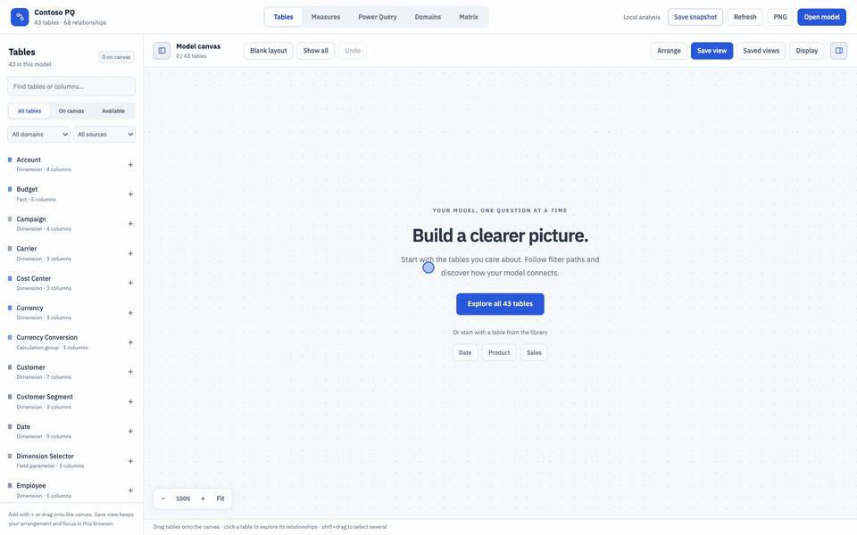

# Viewer guide

Explore the synthetic Contoso Retail model in the [live demo](https://MrPerfectH.github.io/Semantic-Model-Viewer/).
For supported files and setup, see [installation](installation.md).

For short installation and workflow recordings, see the
[illustrated VS Code guide on GitHub](https://github.com/MrPerfectH/Semantic-Model-Viewer/blob/main/docs/vscode-guide.md).
The recordings use the synthetic Contoso Retail model.

## VS Code extension

The viewer also runs inside VS Code. Open a workspace containing a `.SemanticModel`
folder or `model.bim`, then use the **Semantic Model Viewer** Activity Bar or **Semantic
Model Viewer: Open Model…**. It uses the same table workspace, measures, and offline
snapshot format as the web app. Model files refresh when edited; layouts are saved
per model in the VS Code workspace.

See [extension installation and development](../vscode-extension/README.md). The package
is built from `Models/tools/viewer`, so there is one maintained viewer. The web app and Python data pipeline
continue to work as before.

## Share an interactive snapshot

Open your model, choose the starting view, and click **Save snapshot**. Share the
single downloaded HTML file. The recipient opens it in a desktop browser and can
explore **Tables, Measures, Power Query, Domains, and Matrix** without installing anything or
connecting to the semantic model. Saved table views, formulas, comparisons, focus,
layout preferences, appearance, and graph positions travel with the file.

### Generate a snapshot from TMDL

With Node.js 22+, export an offline, interactive HTML snapshot from a TMDL folder:

```bash
node bin/smv.cjs snapshot "Models/demo/Contoso Retail.SemanticModel" --out snapshot.html
```

Open the file in a browser to explore the model. Optionally use `--tables` or
`--measure` to choose the starting view; the full model remains available.
No extra packages or browser are needed to export. See [CLI usage](cli.md).

A snapshot contains the **full model metadata and DAX**, even if the starting canvas
is empty or focused on a few tables. It is frozen at the displayed creation time.
Recipients can use **Save snapshot** again to keep their presentation changes in a
new file. See [snapshot sharing and offline behavior](snapshots.md).

## Screens

Four ways to explore the synthetic **Contoso Retail** demo. Select an image to open it at full size.

### Measures

Follow the logic behind a measure. Trace what feeds it and what depends on it, then compare the DAX without losing your place.

- Search by name, folder, home table, or DAX; spot hidden measures and report usage.
- Switch between dependencies, DAX, and split view. Select a related measure to compare formulas.

| Dependency flow | DAX comparison |
| --- | --- |
| [](img/marketplace/measure-flow.png) | [](img/marketplace/measure-dax.png) |

### Tables

Build a canvas around the tables you care about. Read cardinality and filter direction on the relationship lines, and inspect the selected table beside the diagram.

- Add tables from the library or follow direct and indirect filter paths to related tables.
- Arrange, focus, and pin tables; save named views and navigate with the minimap.

| Relationship canvas | Table inspector |
| --- | --- |
| [](img/marketplace/tables.png) | [](img/marketplace/table-inspector.png) |

### Power Query

See how queries, parameters, functions, and table partitions feed each other. Follow a flow from input to consumer and read the M behind it.

- Select a query for **Inputs** or a parameter for **Used by**. Inspect references and use **Back** to return.
- Read line-numbered M beside the flow, jump through highlighted references, or use **Open full query** and **Copy M**.

| Input flow | M and query details |
| --- | --- |
| [](img/marketplace/power-query-flow.png) | [](img/marketplace/power-query-inspector.png) |

Links come from static analysis of M. No query runs and no source data is read. Unconfirmed links remain explicit; available Power Query definitions are included in shared snapshots.

### Additional (Domains and Matrix)

Step back to see the model as a whole. **Domains** groups related tables into a map you can expand; **Matrix** compares fact tables with their related tables across the model.

| Domains | Fact relationship matrix |
| --- | --- |
| [](img/marketplace/domains.png) | [](img/marketplace/matrix.png) |

### Layouts

Display → Auto layout picks the arrangement, and the Arrange button applies it to the tables
currently on the canvas (Undo restores the previous one).

* **Star** (default) puts the conformed dimensions in one block in the middle and rides the
  facts on an ellipse around it, each fact's own dimensions just outside its seat, so every
  relationship is a short spoke instead of a line across the canvas. A subset with a single
  fact keeps the simpler picture: one centre with its dimensions on a ring.
* **Constellation** is a small force simulation over the whole model — hubs push each other
  apart, a conformed dimension is pulled to the middle of the facts it serves. Good for a
  model with no clear fact/dimension split.
* **Layered** is the Kimball picture people draw by hand: dimensions in a row on top, facts
  underneath, each fact under the middle of the dimensions it uses.

Galaxy rows, star columns, waterfall and grid remain for models these three do not suit.
Lanes are cut for the *chip* the reader sees, not for the collapsed card: a chip title is
held between 11 and 13 CSS pixels at every zoom, so the box grows as the zoom drops, and the
arrangement reserves room for the largest it reaches between 20% zoom and the point cards
come back. That is why a whole model fits at around 20-25% rather than 40% — the same
picture, drawn without two names landing on top of each other.

Two badges appear everywhere a measure is listed:

* grey **eye-off** icon — the measure is `isHidden` in the model (`h: 1` in `model-data.json`),
* blue **`N pg`** pill — the measure is used in the scanned report; the tooltip breaks it
  down per page (`• <page> — 2 visuals, 1 filter`).

Models can also be imported ad hoc: drag a `.pbip` repo folder, a `*.SemanticModel` folder
or a `model.bim` onto the window (parsed in-browser by `js/tmdl-parser.js`, kept in
`localStorage`). Chrome/Edge additionally offer “Connect repo folder…”, which scans a
folder for `*.SemanticModel` and re-parses on every open.

### Power Query



The built-in sample model carries synthetic Power Query metadata, so you can try this tab on the
[live demo](https://MrPerfectH.github.io/Semantic-Model-Viewer/). For your own models, open a TMDL
folder or `model.bim`. A `.pbix` file cannot be read.

Open the **Power Query** workspace next to Tables and Measures. It shows the complete
available metadata inventory as an input → consumer query graph, including disconnected
objects, parameters, functions, explicit table partitions and missing-partition status.
Select an object for read-only, line-numbered M; exact resolved reference occurrences
navigate to their input. Back restores selection, filters, viewport and inspector scroll.
No M runs and no source data is fetched. TMDL partition sources/shared expressions and
corresponding `model.bim` metadata are supported, with explicit missing/non-M states.

**All / Connected / Disconnected** filters use resolved incident Power Query references
in the complete model, never semantic relationships or source co-location. Disconnected
means zero resolved edges, with an uncertainty caveat; it does not prove independence.
Category filters hide canvas/library rows; search narrows the library and dims canvas
nonmatches. Counts retain total inventory. A filtered selection retains its inspector
and offers Show all. Reset filters preserves selection/layout; model changes clear them.

Use **Open full query** beneath the selected query name for a nearly full-window M
reader with 14px code, line wrapping, exact Copy M and clickable references. Escape
returns focus to the opener. Source text and original line endings are never reformatted.
Query connectors use thin straight segments and small open chevrons pointing from input
to consumer; click a connector for reference details.

Pan, zoom, Fit and the visible-canvas minimap explore all components without upstream
expansion caps. Analysis builds atomically in a cancellable background worker; cancellation
and worker failure do not imply absent dependencies. Static findings remain partial:
dynamic/missing/ambiguous references, unsupported syntax, cycles and analysis notices
remain explicit and do not establish execution order or complete lineage.

**Save snapshot** includes available Power Query definitions with exact M and the
current Flow/Canvas presentation. Offline files support static dependency inspection,
clickable references and the full M reader without executing queries or connecting
to sources. Older snapshots and pre-generated JSON may omit M.
See [metadata limitations](power-query-contract.md), the
[presentation contract](power-query-redesign/interface-contract-v2.md), and
[filter policy](power-query-redesign/filter-addendum.md). Original verification
remains historical; redesigned UI acceptance is recorded separately.

### Following a Power Query flow

Choose a query, parameter or table to set a flow target. Inspecting an M reference,
canvas card, or an **Inputs / Consumers** button keeps that target fixed. The purple
outline marks the target; stronger blue links trace the inspected branch using only
resolved M references. These are separate from semantic model relationships.

Use **Hide unrelated** to see the flow, **Trace this query** to choose the inspected
query as the new target, or **Inspect target** to return to its M. Direction and
distance apply to the target. **Back** restores navigation, filters and reader state;
**Undo** restores layout edits. **Clear flow** returns to selection focus; **Show all**
also restores the complete layout membership. Arrange remains input → consumer and
preserves positions until explicitly invoked. Static analysis is partial; cycles and
uncertainty remain visible. No M is executed. Available M definitions are included in shared snapshots.


## Table and column references

The Measures graph defaults to measures only. Enable **Show table and column references**
to add source tables, using the same colors as the Tables canvas. Cards contain only the
columns connected to measures visible in the graph. A dashed **Whole table** link attaches
to the table header (for example, `COUNTROWS(Sales)`); a solid column link attaches to its
row (for example, `SUM(Sales[Amount])`). A measure's home table does not imply a dependency.

In the left library, choose **Table or column**. Expand a table and choose **Use whole
table** or any column; the picker includes columns with no detected consumers. The library
then lists direct references first, followed by indirect dependents. Change the source to
return to the picker. You can also select a source table header in the graph to find
measures referencing that table or any of its columns.
Select a column row to narrow the source. The table details drawer also provides
**Find dependent measures**, and each column has **Find measures**. Source analysis includes
indirect dependents through measures, a **Direct only** filter, and searchable results.
Selecting a dependent measure inspects its DAX without changing the source; **Analyze this
measure** returns to measure analysis. Source selection, graph settings, and inspected DAX
are preserved in interactive snapshots.

Each formula card owns its reference summary. Original DAX shows direct references only;
**Inline measures** shows references resolved from the expanded expression, including
columns introduced by inlined measures. Comparison cards retain their own reference scope.
The DAX pane opens when a dependent measure is inspected; before that, the graph uses
the available width. Inline, formatting and source library settings also survive snapshots.

This is static DAX reference detection, not complete engine lineage. Calculated columns
and calculated tables can be sources, but their defining expressions are not expanded.
Relationship filter propagation and calculation-item expressions are not traced. Qualified
column references and explicit table references are resolved against the model; unqualified
bracket names resolve to measures first, then columns in the measure's home table. Ambiguous
row-context references outside that table and virtual columns are not fully resolved.
Graphs are limited to 500 measures and 200 source table/column rows, with visible notices;
dependent-measure lists show up to 120 matches at once and can be narrowed by search.
