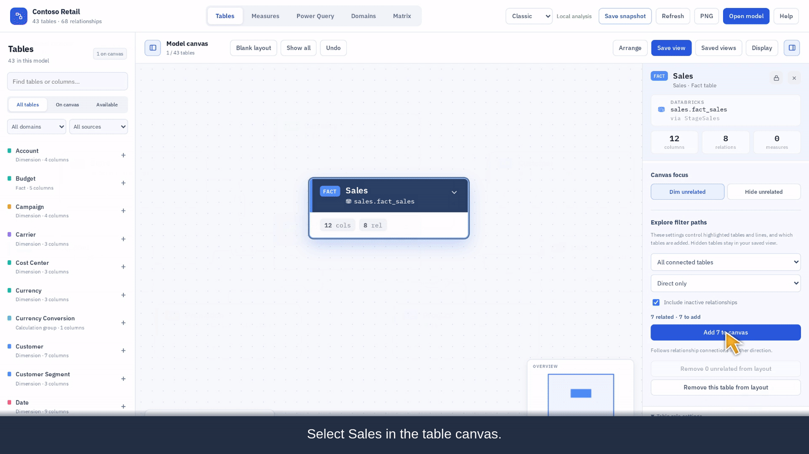
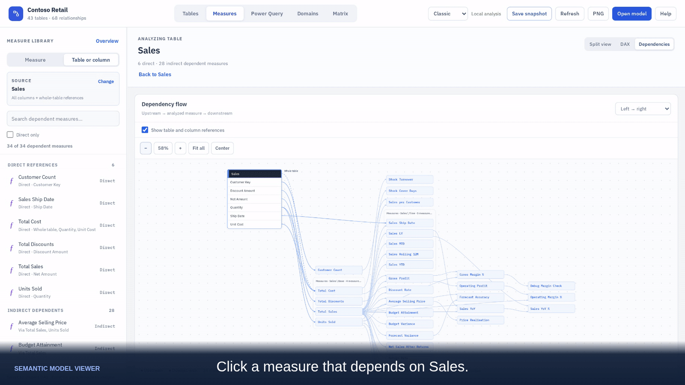
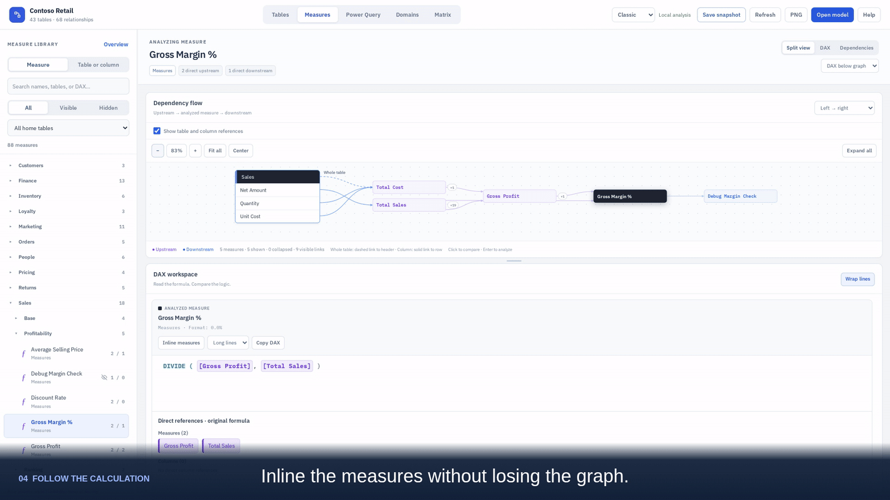
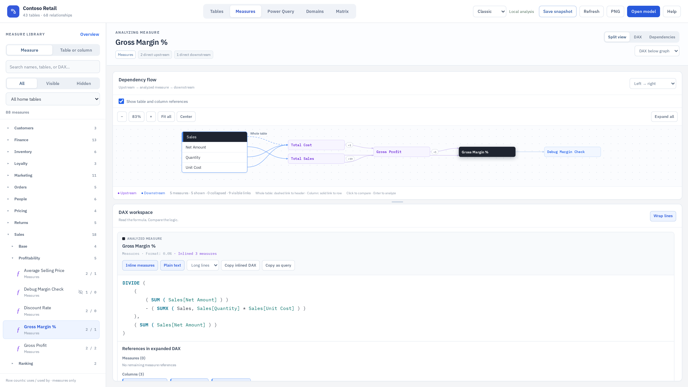

# Get started with Semantic Model Viewer in VS Code

Install the extension, open a local Power BI semantic model, and follow its tables and DAX without leaving VS Code.

Use **version 0.4.0 or newer** for the table and column dependency features shown below. The feature recordings were made during development; the installation clip shows 0.3.9, using the same installation steps.

## Install the extension

1. Open **Extensions** in VS Code: **Cmd+Shift+X** on macOS or **Ctrl+Shift+X** on Windows/Linux.
2. Search for **Semantic Model Viewer**. Select the extension published by **MrPerfectH**.
   For an exact match, search `@id:MrPerfectH.semantic-model-viewer`.
3. Choose **Install** and follow the VS Code prompts.
4. Open your project folder and select **Semantic Models** in the Activity Bar.

If Marketplace installation is unavailable, download `semantic-model-viewer-<version>.vsix` from [GitHub Releases](https://github.com/MrPerfectH/Semantic-Model-Viewer/releases/latest). Open the Command Palette (**Cmd+Shift+P** on macOS, **Ctrl+Shift+P** on Windows/Linux), run **Extensions: Install from VSIX…**, and choose the downloaded file. To update a VSIX installation, repeat with the newer file. Reload VS Code if prompted.

Use VS Code 1.85 or newer. Local file exploration does not require Python, Power BI Desktop, or a Fabric connection.

[Watch installation and finding the model list — 10 seconds](https://MrPerfectH.github.io/Semantic-Model-Viewer/media/vscode-guide/install-extension.mp4)


## Open a semantic model

1. Use **File → Open Folder…** to open your PBIP project folder or a repository containing your models.
2. Select **Semantic Models** in the Activity Bar. The extension lists compatible models in the workspace; choose the one you want to explore.
3. Start in **Tables**, or switch to **Measures** to inspect a calculation.

Supported local inputs are `*.SemanticModel` folders with TMDL definitions and `model.bim`. A `.pbix` file alone is not a supported local input. If a model is missing, check the opened folder and run **Semantic Model Viewer: Refresh Model List**. You can also right-click a supported model and choose **Open in Semantic Model Viewer**.

[Watch opening a model and following it into DAX — 35 seconds](https://MrPerfectH.github.io/Semantic-Model-Viewer/media/vscode-guide/vscode-to-dax-v4.mp4)

## Focus on part of the table canvas

Select a table to highlight its relationships while unrelated tables dim. Switch to another table to follow a different path without losing the surrounding layout. Choose **Hide unrelated**, then **Arrange**, for a larger focused diagram. Hiding tables changes the view, not the model files.

[Watch the table workflow — 24 seconds](https://MrPerfectH.github.io/Semantic-Model-Viewer/media/vscode-guide/focus-tables.mp4)


## From a table to dependent measures

### 1. Find the measures that use a table

Select **Sales** in the table canvas, then choose **Find dependent measures** in the table inspector. The measure library lists direct and indirect references to that table. Use **Direct only** to narrow the list.



For a single column, choose **Find measures** beside that column in the inspector.

### 2. Inspect a measure, then follow its dependencies

Click a dependent measure to inspect its formula while keeping Sales as the source. Double-click its graph node to make it the analyzed measure; the focused measure becomes black.



### 3. Expand the calculation

Keep **Split view** selected and choose **DAX below graph**. Choose **Inline measures** to expand the referenced calculations. **Plain text** removes the inline labels so you can read the expanded expression while the Sales dependency chain remains visible above it.



Dependency analysis inspects static DAX references; it does not execute DAX or simulate relationship filter propagation.

## What is new in version 0.4.0

- **Table and column dependency analysis:** find direct and indirect dependent measures, inspect formulas while retaining source context, and navigate from highlighted DAX references.
- **Measure browsing:** a searchable formula overview and clearer navigation between sources and measures.
- **Snapshot improvements:** preserve more analysis state, including the selected source, inspected formula, filters, and layout choices. Interactive HTML snapshots already exist; these changes extend them.

See the [0.4.0 release notes](releases/0.4.0.md) for the full list of changes.




## Share a view with a colleague

**Save snapshot** creates a self-contained HTML file that a colleague can explore in a browser. It contains model metadata, DAX, and available Power Query definitions, so share it with the intended audience. No model queries run in the snapshot.

## CLI and working with AI agents

The repository also includes a [snapshot CLI](cli.md) that an AI coding agent can invoke to create an interactive HTML view of a local model:

```bash
node bin/smv.cjs snapshot "Models/demo/Contoso Retail.SemanticModel" --tables Sales,Customer,Date --out sales-view.html
```

Run this from a repository checkout with Node.js 22 or newer. It reads local model definitions and exports a snapshot; it does not execute DAX or change the model files.

Additional CLI tools that can support working with AI agents are in development. They are separate from the stable VS Code features demonstrated above. This guide does not yet include a recording of those development tools.

All examples here use the synthetic Contoso Retail model. You can also [try the browser demo](https://MrPerfectH.github.io/Semantic-Model-Viewer/) before installing the extension.
