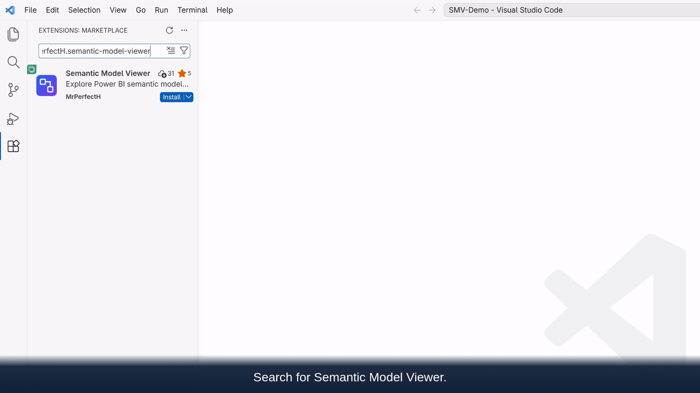
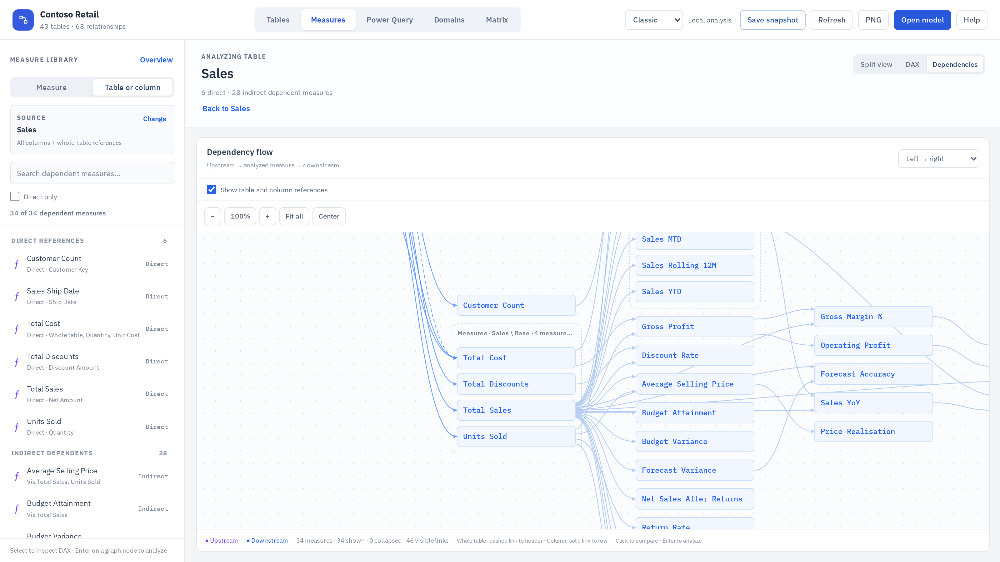
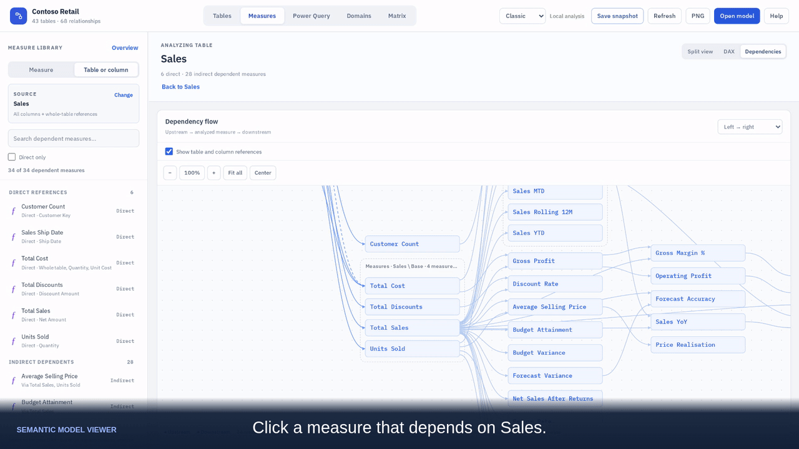
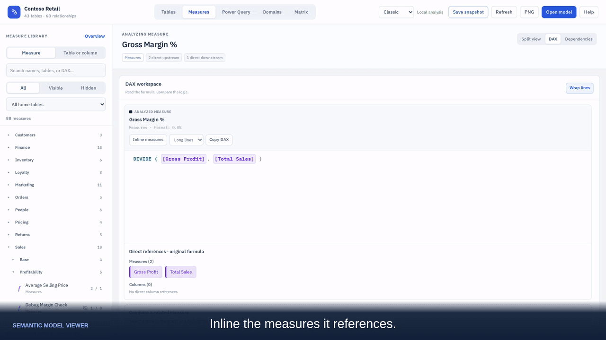
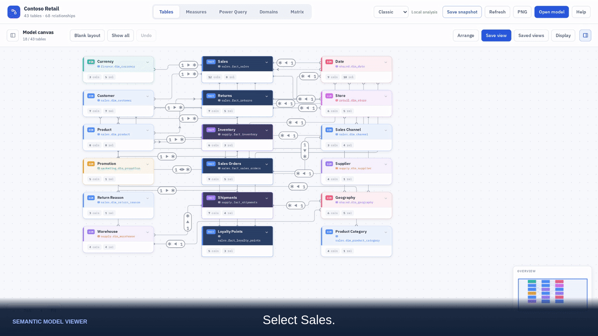
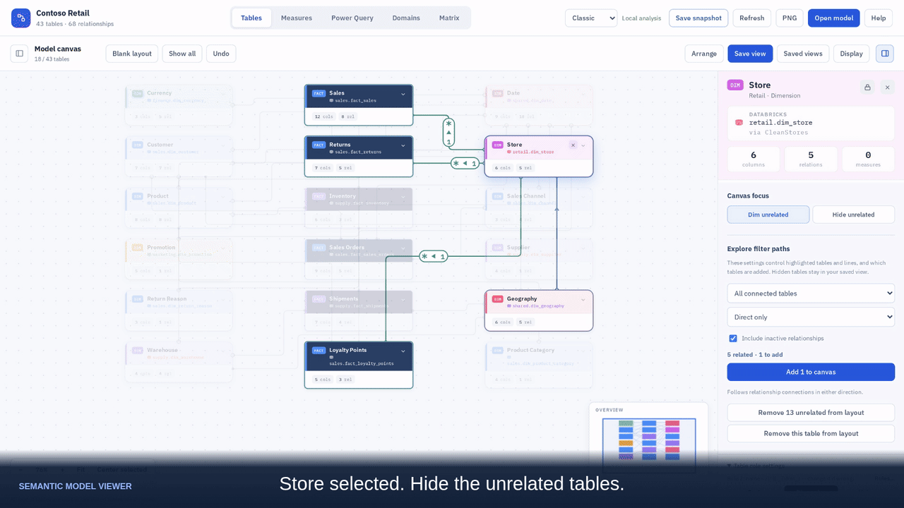
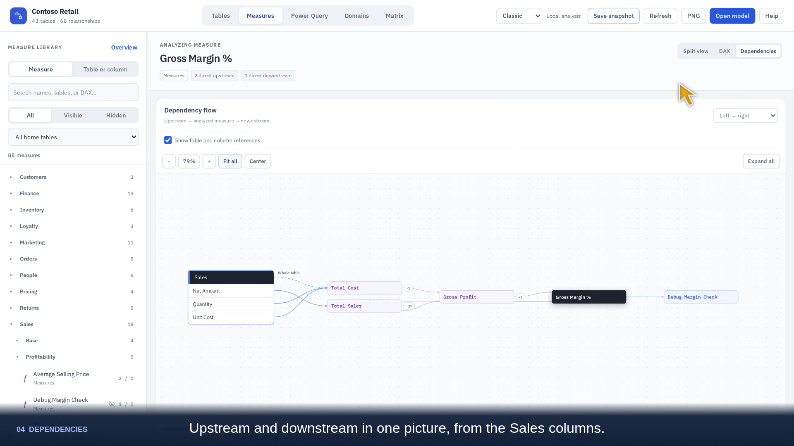
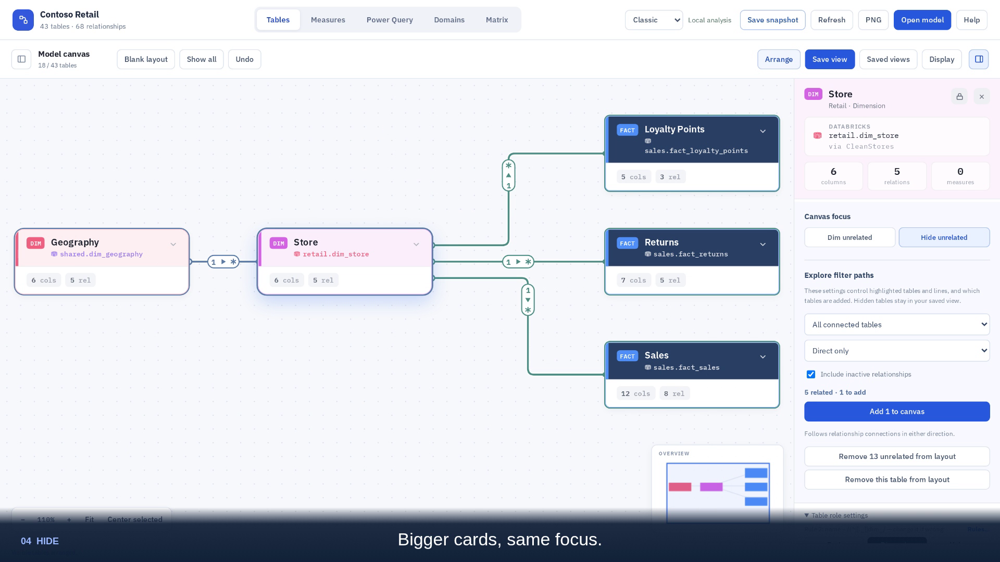

# Get started with Semantic Model Viewer in VS Code

Install the extension, open a local Power BI semantic model, and follow its tables and DAX without leaving VS Code.

**Feature preview:** the feature recordings below use a development build. The latest public GitHub release checked on 23 October 2026 is **0.3.9**. New dependency and snapshot improvements will be available with the next release; installing 0.3.9 does not enable every feature shown here.

## Install the extension

1. Open **Extensions** in VS Code: **Cmd+Shift+X** on macOS or **Ctrl+Shift+X** on Windows/Linux.
2. Search for **Semantic Model Viewer**. Select the extension published by **MrPerfectH**.
   For an exact match, search `@id:MrPerfectH.semantic-model-viewer`.
3. Choose **Install** and follow the VS Code prompts.
4. Open your project folder and select **Semantic Models** in the Activity Bar.

If Marketplace installation is unavailable, download `semantic-model-viewer-<version>.vsix` from [GitHub Releases](https://github.com/MrPerfectH/Semantic-Model-Viewer/releases/latest). Open the Command Palette (**Cmd+Shift+P** on macOS, **Ctrl+Shift+P** on Windows/Linux), run **Extensions: Install from VSIX…**, and choose the downloaded file. To update a VSIX installation, repeat with the newer file. Reload VS Code if prompted.

Use VS Code 1.85 or newer. Local file exploration does not require Python, Power BI Desktop, or a Fabric connection.

[Watch installation and finding the model list — 8 seconds](media/vscode-guide/install-extension.mp4)

## Open a semantic model

1. Use **File → Open Folder…** to open your PBIP project folder or a repository containing your models.
2. Select **Semantic Models** in the Activity Bar. The extension lists compatible models in the workspace; choose the one you want to explore.
3. Start in **Tables**, or switch to **Measures** to inspect a calculation.

Supported local inputs are `*.SemanticModel` folders with TMDL definitions and `model.bim`. A `.pbix` file alone is not a supported local input. If a model is missing, check the opened folder and run **Semantic Model Viewer: Refresh Model List**. You can also right-click a supported model and choose **Open in Semantic Model Viewer**.

[Watch opening a model and following it into DAX — 37 seconds](media/vscode-guide/vscode-to-dax.mp4)

## From a table to dependent measures

Select a table or column, then choose **Find dependent measures**. Explore the measures that directly or indirectly reference that source. Use **Direct only** to narrow the list.

Click a dependent measure to inspect its formula. Double-click its graph node to make it the analyzed measure; the focused measure becomes black. Open DAX and use **Inline measures** to expand referenced calculations.

Dependency analysis inspects static DAX references; it does not execute DAX or simulate relationship filter propagation.

## Focus on part of the table canvas

Select a table to highlight its relationships while unrelated tables dim. Switch to another table to follow a different path without losing the surrounding layout. Choose **Hide unrelated**, then **Arrange**, for a larger focused diagram. Hiding tables changes the view, not the model files.

[Watch the table workflow — 24 seconds](media/vscode-guide/focus-tables.mp4)

## What is coming in the next extension update

- **Table and column dependency analysis:** find direct and indirect dependent measures, inspect formulas while retaining source context, and navigate from highlighted DAX references.
- **Measure browsing:** a searchable formula overview and clearer navigation between sources and measures.
- **Snapshot improvements:** preserve more analysis state, including the selected source, inspected formula, filters, and layout choices. Interactive HTML snapshots already exist; these changes extend them.

The final release notes define the shipped scope. These are preview examples rather than a claim that the development build is already the stable release.

## Share a view with a colleague

**Save snapshot** creates a self-contained HTML file that a colleague can explore in a browser. It contains model metadata, DAX, and available Power Query definitions, so share it with the intended audience. No model queries run in the snapshot.

All examples here use the synthetic Contoso Retail model. You can also [try the browser demo](https://MrPerfectH.github.io/Semantic-Model-Viewer/) before installing the extension.
